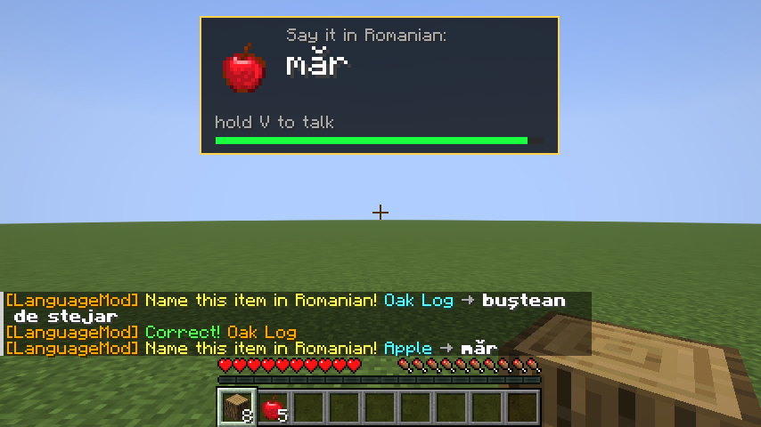
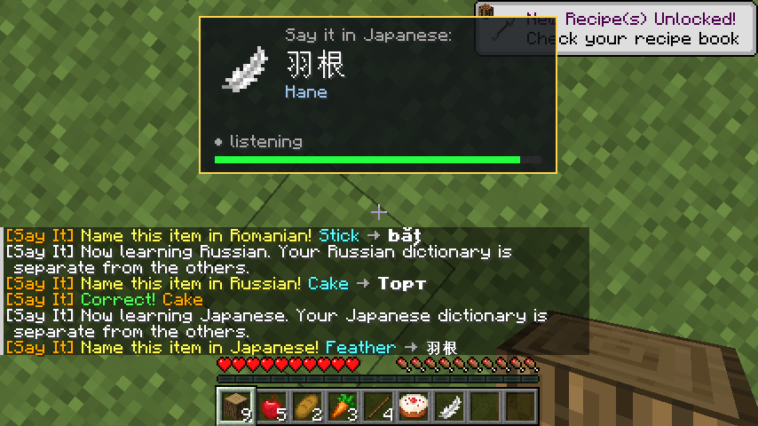
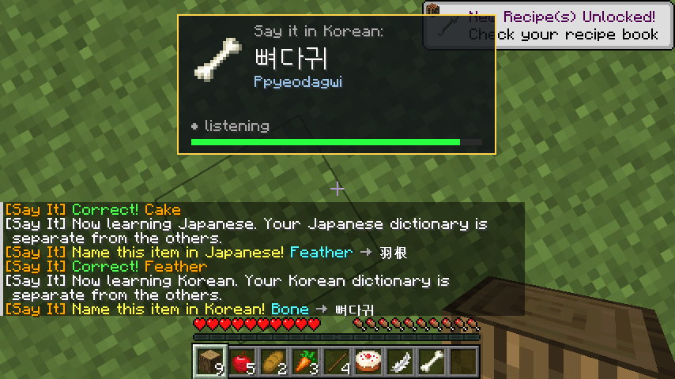
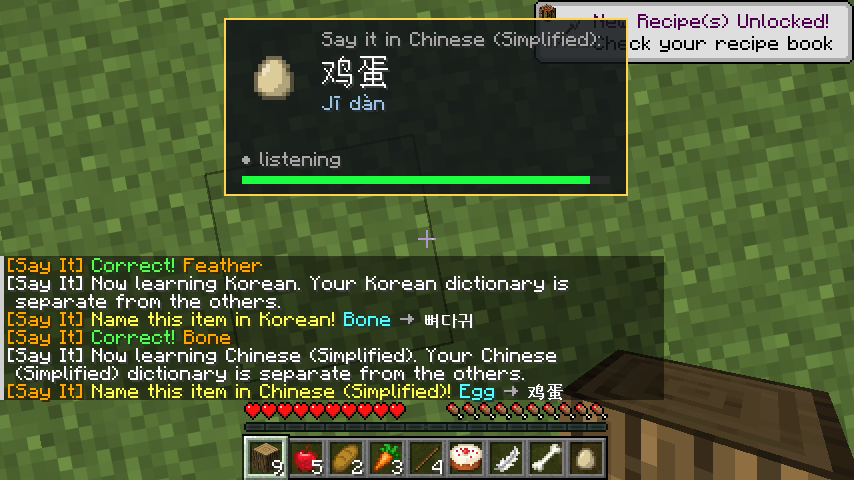
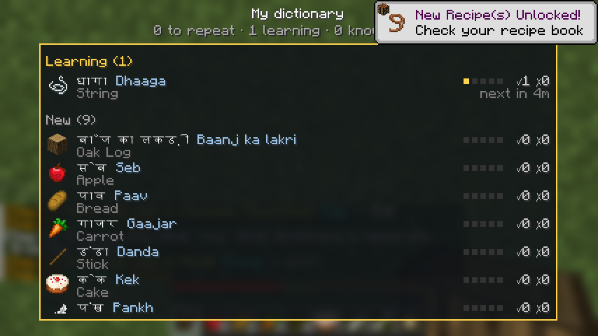
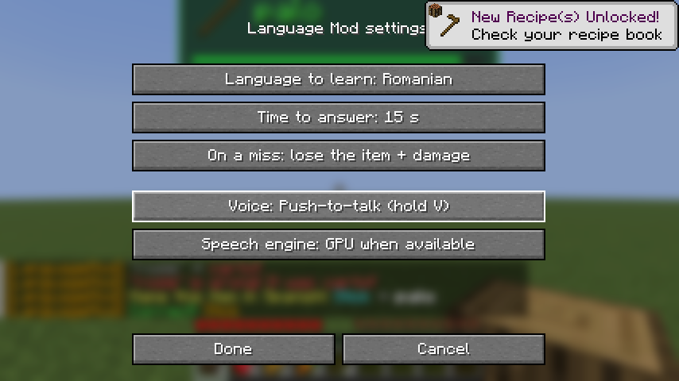
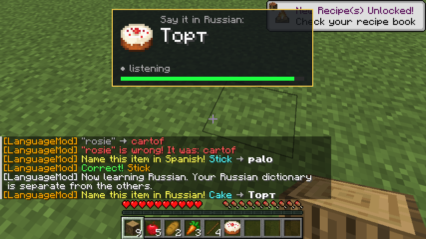
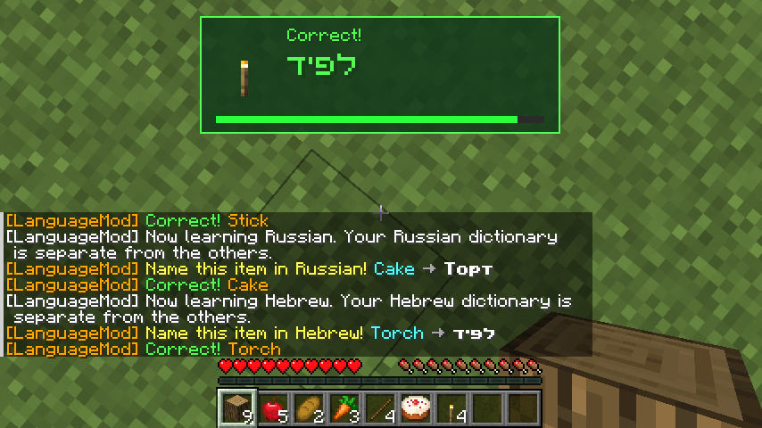
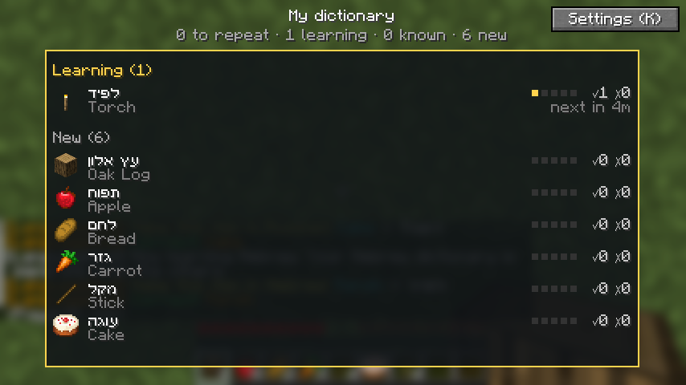

# Say It Or Lose It (Minecraft 1.21.11, Fabric)

Learn a language while you play. Every time a new item lands in your inventory, a popup shows
the item and its name in the language you're learning. Say it out loud (or type it) before the
timer runs out, or you take damage (and, if you want it harder, lose the item).

Inspired by Fawcette's "name every item in another language" challenge videos.



## Features

- **Popup** with the item icon, the word to read, and a draining time bar. Wrong tries colour
  each letter green or red so you see which part you got right.
- **Voice answers**: speech-to-text runs on your own PC with [whisper.cpp](https://github.com/ggml-org/whisper.cpp)
  (nothing is sent online). Open mic by default, or push-to-talk.
  Optional **GPU** mode: about 0.2 s per answer instead of about 4.5 s on the CPU.
- **Typed answers**: while a word is asked, a normal chat line is your answer (others don't see it).
- **Your dictionary** (press **J**): every word you've met, what you know, what needs repeating.
  Words come back as reviews on a spaced schedule (5 min, 20 min, 1 h, 3 h, 10 h of play time);
  missed words come back first.
- **Languages**: Spanish, French, German, Italian, Portuguese (Brazil), Russian, Japanese, Korean,
  Chinese (Simplified), Hindi, Romanian and Hebrew (Hebrew reads right to left). Each language
  keeps its own dictionary.
- **How to read it**: words in other alphabets show their pronunciation in small Latin letters
  underneath, in the popup and in the dictionary (עפר → Afar, Торт → Tort, 土 → Tsuchi).
- **Settings screen** (press **K**): language, time to answer, what a miss does, voice mode, GPU.
- **Works on any server**: on a server that runs the mod, the server enforces the rules (real
  damage, items deleted). On a server without it, the mod runs on your side
  ("client-only mode"): a miss flashes the screen red and shakes the camera instead of
  dealing real damage.

| Japanese | Korean | Chinese | Hindi |
|---|---|---|---|
|  |  |  |  |

| Settings | Russian | Hebrew | Dictionary |
|---|---|---|---|
|  |  |  |  |

## Install

1. Install [Fabric Loader](https://fabricmc.net/use/) 0.17 or newer for Minecraft **1.21.11**
   (or use a launcher like Prism / PolyMC and pick Fabric).
2. Put [Fabric API](https://modrinth.com/mod/fabric-api) and `say-it-or-lose-it-<version>.jar` (from [Releases](https://github.com/AvinadavCoh/minecraft-language-mod/releases)) in your `mods` folder.
3. Start the game and join a world. The first time, the mod asks whether to download the voice
   model (`ggml-small-q5_1.bin`, 190 MB, from Hugging Face). Say no to type your answers instead;
   you can download it later from the settings (K).

## Keys

| Key | What it does |
|---|---|
| **J** | Open / close your dictionary |
| **K** | Settings |
| **V** | Talk (only in push-to-talk mode) |

All three can be changed in Minecraft's Controls menu.

## Changing language

Press **K**, click **Language to learn** until it shows the one you want, then **Done**.
You can do this any time, in the middle of a game:

- The full word list for that language is built on your PC from Minecraft's own translations
  the first time you pick it (a second or so).
- Your progress is kept per language: switching to Russian starts a fresh Russian dictionary,
  and switching back to Romanian brings your Romanian one back.
- Items you're carrying are asked one by one, a few seconds apart, not all at once.

On a server that runs the mod, the server's config decides the language and rules, so only the
voice settings can be changed there.

## Faster voice with an NVIDIA GPU (optional)

1. Download `whisper-cublas-12.4.0-bin-x64.zip` from the
   [whisper.cpp v1.9.2 release](https://github.com/ggml-org/whisper.cpp/releases/tag/v1.9.2) (639 MB).
   The smaller CUDA 11.8 zip doesn't include cuBLAS and silently falls back to the CPU.
2. Unzip it into `.minecraft/config/languagemod/whisper-gpu/` (so that
   `whisper-gpu/Release/whisper-server.exe` exists), or set `"gpuServer"` in `voice.json` to
   wherever `whisper-server.exe` is.
3. Restart the game. The log shows `GPU Whisper ready`. The very first start on a new PC can
   take about 2 minutes while CUDA compiles its kernels; the CPU answers until then.

## Config files

Everything lives in `.minecraft/config/languagemod/`:

- `config.json`: rules (language, timer, damage, delete item on miss, review timing, ...).
- `voice.json`: voice mode, microphone, GPU, model, `saveRecordings` (saves what the mic heard,
  handy if voice isn't picking you up).
- `<language>.json`: word lists. You can add your own accepted answers to any item; the first
  answer is the word the popup shows.

`/languagemod reload` re-reads them on a server.

## Building

Needs a JDK 21 installed (Gradle finds it via `gradle/gradle-daemon-jvm.properties`).

```
./gradlew build                 # jar in build/libs
./gradlew test                  # unit tests
./gradlew runClientGameTest     # bot plays through every feature and takes screenshots
```

## Credits and licenses

- Mod code: MIT (see `LICENSE`).
- [whisper.cpp](https://github.com/ggml-org/whisper.cpp) (MIT) and
  [whisper-jni](https://github.com/GiviMAD/whisper-jni) (Apache-2.0, bundled).
- Item names come from Minecraft's own translation files on your PC; the mod doesn't ship them.
  The short hand-written Romanian and Spanish starter lists are the mod's own.
